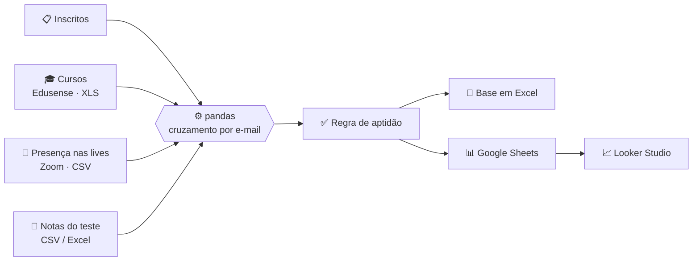

# 🎓 Pipeline de Aptidão para Prova 

 

 

 

 

 

 

> Automatiza o cruzamento de cursos, notas e presença em lives para descobrir, sem planilha manual, quais alunos estão **aptos a fazer a prova final**. 

 

--- 

 

## 💡 O problema 

 

Antes, o acompanhamento era feito à mão: baixar relatórios de plataformas diferentes, cruzar tudo pelo e-mail e atualizar uma planilha. O processo era lento e propenso a erros de comparação entre nomes, cursos parecidos e datas. 

 

**Esta automação faz tudo isso em uma única execução**, e o resultado alimenta um painel no Looker Studio. 

 

--- 

 

## ⚙️ Como funciona 

 



 

--- 

 

## 🏆 Regra de aptidão 

 

Um aluno é considerado **apto** quando cumpre os dois critérios ao mesmo tempo: 

 

| Critério | Exigência | 

|----------|-----------| 

| 📚 Cursos | Todos os cursos obrigatórios com status **Concluído** | 

| 🎥 Lives | Presença em **pelo menos 90%** das lives | 

 

A cada execução, o script também atualiza a **maior nota** do teste final e mantém sempre o **status mais avançado** de cada curso, então um dado mais antigo nunca sobrescreve um mais recente. 

 

--- 

 

## 📥 Fontes de dados 

 

| Dado | Formato | Origem | 

|------|---------|--------| 

| Inscritos | `.xlsx` ou `.csv` | Lista exportada pela área responsável | 

| Progresso nos cursos | `.xls` ou `.xlsx` | Plataforma **Edusense**, relatório de cursos | 

| Presença nas lives | `.csv` | Relatório de participantes do **Zoom**, baixado após cada live | 

| Nota do teste final | `.xlsx` ou `.csv` | Exportação da plataforma de avaliação | 

 

As colunas são identificadas pelo nome, então pequenas variações no cabeçalho são aceitas. O arquivo precisa ter uma coluna de e-mail ou login. 

 

--- 

 

## 🚀 Como executar 

 

O script foi feito para rodar no **Google Colab**, que cuida da autenticação e do upload dos arquivos. 

 

1. Abra o `src/main.py` no Colab. 

2. Ajuste as configurações no topo do arquivo: ID da planilha, caminho da base, nomes dos cursos e das lives. 

3. Execute e escolha o modo: 

   - **[C] Novo mês:** cria a base a partir dos inscritos. 

   - **[A] Adicionar/Mesclar:** acrescenta novos inscritos à base existente. 

   - **[U] Atualizar:** atualiza apenas cursos, notas e lives. 

4. Envie os arquivos quando solicitado. Para cada CSV do Zoom, informe a live correspondente. 

5. Ao final, a base é salva no Drive (com backup da versão anterior) e enviada ao Google Sheets. 

 

--- 

 

## 📁 Estrutura do projeto 

 

``` 

pipeline-aptidao-prova/ 

├── src/ 

│   └── main.py          # código principal da automação 

├── README.md 

└── requirements.txt 

``` 

 

--- 

 

## 🛠️ Tecnologias 

 

`Python` · `pandas` · `gspread` · `google-auth` · `Google Colab` · `Google Sheets` · `Looker Studio` 

 

--- 

 

## 🔭 Próximos passos 

 

- **Separar em módulos:** leitura, regras de negócio e exportação estão no mesmo arquivo. 

- **Configuração externa:** ID da planilha e caminhos deveriam vir de variáveis de ambiente. 

- **Testes automatizados:** cobrir a regra de status (ex.: "Dia 1" x "Dia 10") e o cálculo de aptidão. 

- **Escrita mais segura:** montar todos os dados antes de limpar a aba do Google Sheets. 

- **Validação de entradas:** tratar exceções de forma específica, sem `except` genéricos. 

 

--- 

 

## 👤 Autor 

Maria Eduarda Tavares — https://www.linkedin.com/in/madulv/
